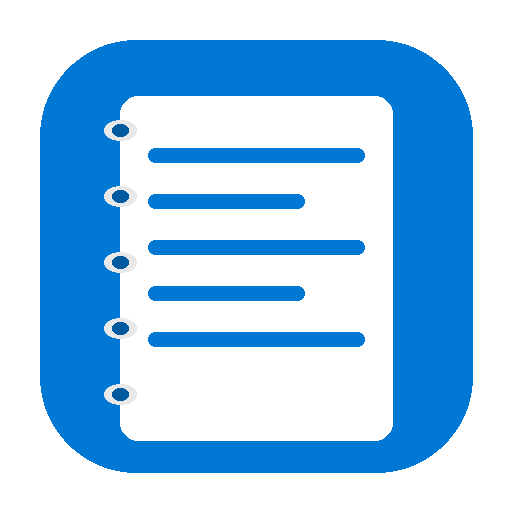
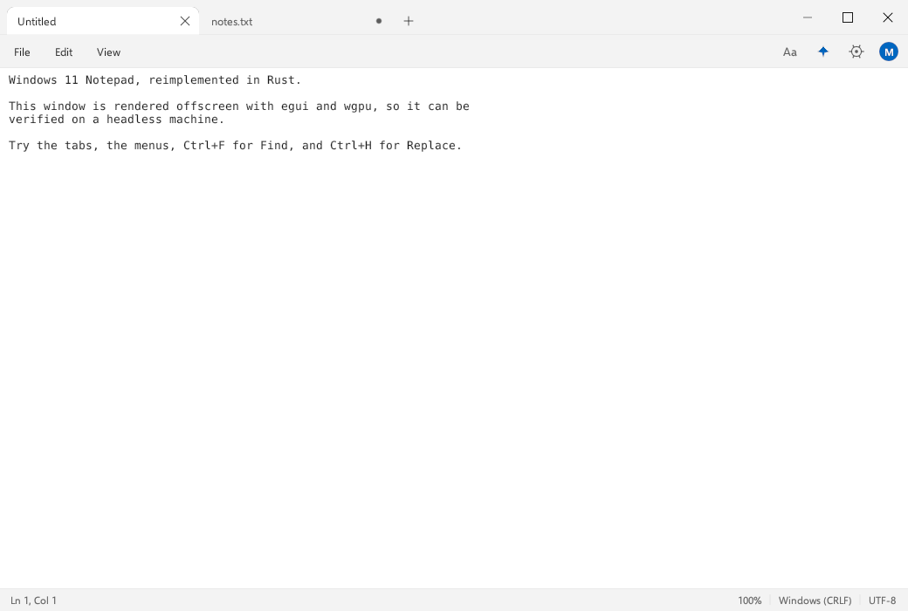
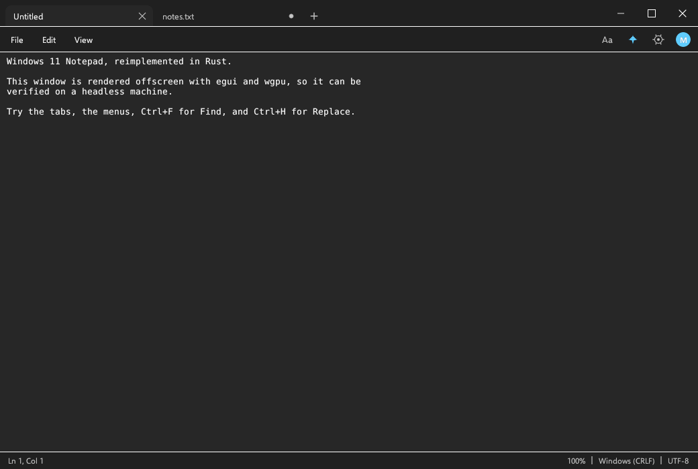
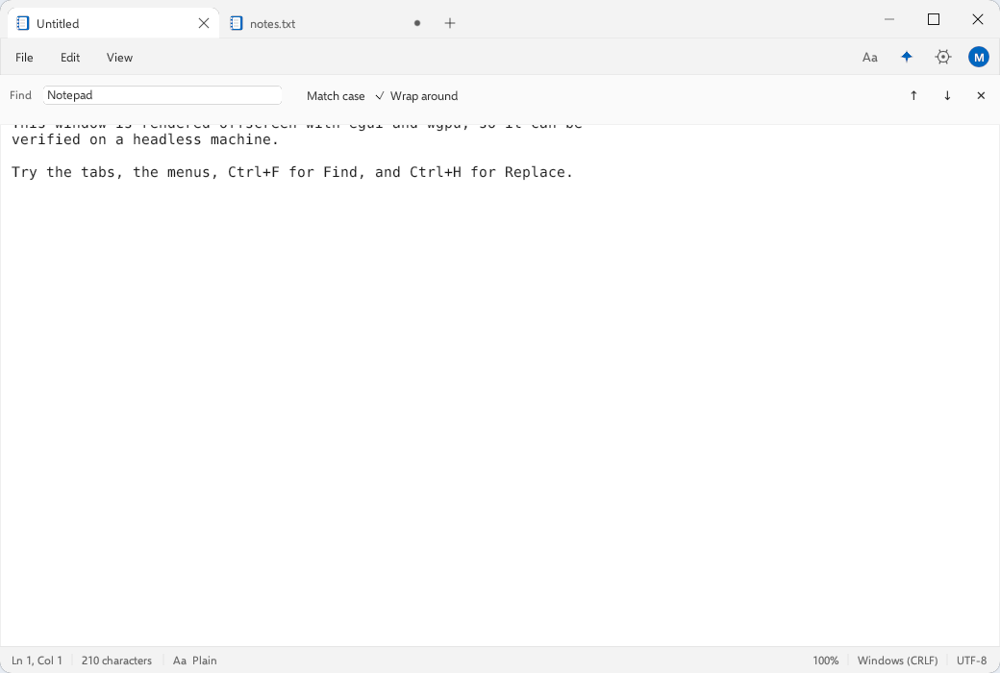
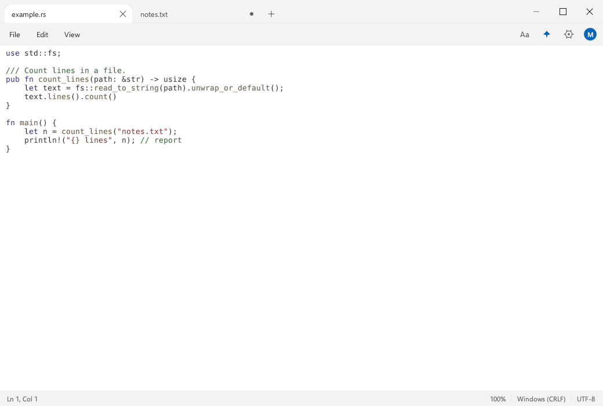

<p align="center">
  
</p>

<h1 align="center">Elevenpad</h1>

<p align="center">
  A Windows 11 Notepad reimplementation for Linux, in Rust with egui.<br>
  Tabs, find and replace, CRLF handling and the Windows 11 look, natively on Wayland and X11.
</p>

<p align="center">
  
  <a href="https://github.com/emilk/egui"></a>
  
  <a href="LICENSE"></a>
  <a href="https://github.com/tobioffice/elevenpad/releases"></a>
  <a href="https://github.com/tobioffice/elevenpad/releases"></a>
</p>

<p align="center">
  
</p>

<p align="center">
  
  
</p>

<p align="center">
  
</p>

## Why

Windows 11 Notepad is a clean, fast text editor with a familiar tabbed layout.
This project reimplements that experience for Linux as a single native binary,
without Electron, GTK, Qt or a web view.

## Features

| | |
|---|---|
| **Tabs** | Windows 11 tab strip, new tab button, modified dot, per-tab close, active tab merges into the editor |
| **Editing** | Undo and redo, cut, copy, paste, delete, select all, time and date insertion |
| **Find and replace** | Find bar with match case, wrap around, next and previous, replace one, replace all, match feedback |
| **Navigation** | Go to line, line and column readout in the status bar |
| **View** | Word wrap, zoom from 20% to 500% with Ctrl and mouse wheel, status bar toggle, always on top |
| **Files** | CRLF and LF preserved on save, UTF-8 BOM detection, drag and drop to open, Windows 11 style dialogs that hide dot folders by default with a Show hidden items toggle |
| **Window** | Rounded window corners, with an X11 shape mask so they work even without a compositing manager, plus a View toggle, native edge and corner resizing, title bar dragging, double click to maximize, custom caption buttons |
| **Themes** | Light and dark palettes matching Windows 11 chrome colors |
| **Text** | Selawik, metric compatible with Segoe UI, and DejaVu Sans Mono for the editor |
| **Code** | Lightweight syntax highlighting for Rust, Python, JavaScript, TypeScript, C, C++, Go, Java, JSON, TOML, YAML, shell and SQL |
| **Integration** | Opens files from the file manager ("Open with"), multiple files open in tabs, `elevenpad FILE...` on the command line |

## Install

### AppImage (recommended)

```bash
curl -LO https://github.com/tobioffice/elevenpad/releases/latest/download/Elevenpad-0.4.4-x86_64.AppImage
chmod +x Elevenpad-0.4.4-x86_64.AppImage
./Elevenpad-0.4.4-x86_64.AppImage
```

If FUSE 2 is not installed:

```bash
./Elevenpad-0.4.4-x86_64.AppImage --appimage-extract-and-run
```

### Tarball

```bash
curl -LO https://github.com/tobioffice/elevenpad/releases/latest/download/Elevenpad-0.4.4-linux-x86_64.tar.gz
tar xzf Elevenpad-0.4.4-linux-x86_64.tar.gz
cd elevenpad-0.4.4
./install.sh          # installs to ~/.local/bin, no root needed
elevenpad
```

### From source

```bash
git clone https://github.com/tobioffice/elevenpad.git
cd elevenpad
cargo run --release
./scripts/build-appimage.sh    # rebuild the AppImage
```

Requires Rust stable and a Vulkan or OpenGL driver. Wayland and X11 are both
supported. The prebuilt binary needs glibc 2.39 or newer (Ubuntu 24.04+, Fedora 40+,
Debian 13+).

## Shortcuts

| Action | Shortcut |
|---|---|
| New tab | `Ctrl+T` |
| Close tab | `Ctrl+W` |
| Open | `Ctrl+O` |
| Save | `Ctrl+S` |
| Save as | `Ctrl+Shift+S` |
| Find | `Ctrl+F` |
| Find next / previous | `F3` / `Shift+F3` |
| Replace | `Ctrl+H` |
| Go to line | `Ctrl+G` |
| Undo / redo | `Ctrl+Z` / `Ctrl+Y` |
| Select all | `Ctrl+A` |
| Time and date | `F5` |
| Zoom in / out / reset | `Ctrl++` / `Ctrl+-` / `Ctrl+0` |

## Architecture

```
src/app.rs       window chrome, tabs, menus, editor, find bar, dialogs, shortcuts
src/doc.rs       document model, file IO, encodings, undo and redo
src/theme.rs     Windows 11 palettes, fonts, egui style
src/icons.rs     painter-drawn icons, no icon font dependency
src/bin/shot.rs  offscreen renderer used to verify the UI headlessly
src/bin/probe.rs headless interaction probe for focus and drag behaviour
scripts/         icon generation and AppImage build
packaging/       per-user install script for the tarball
```

Verification is part of the build: `cargo test` covers the document model, the
offscreen renderer produces the screenshots in this README, and the probe asserts
that clicks anywhere in the editor take focus and that the drag region emits
`StartDrag`.

## Limitations

- Copilot, AI rewrite, spell check and the formatting toolbar are stubs.
- Print and page setup are disabled.
- The file picker is drawn in-app rather than using the desktop portal.
- Plain text only, like the default Notepad surface.
- Window decorations are drawn by the app, so the 6 px border is the resize affordance.

## License

MIT. Not affiliated with, endorsed by, or sponsored by Microsoft. Windows is a
trademark of Microsoft Corporation.
